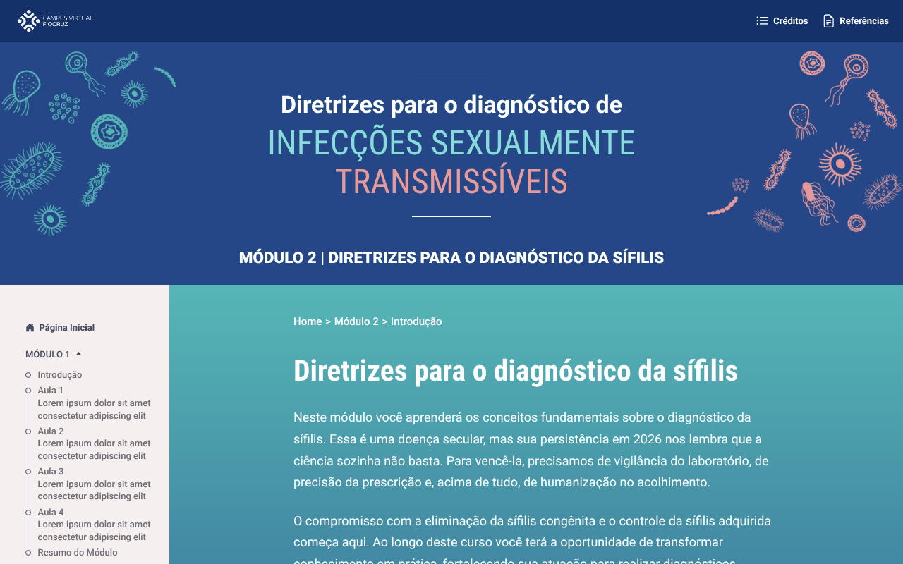
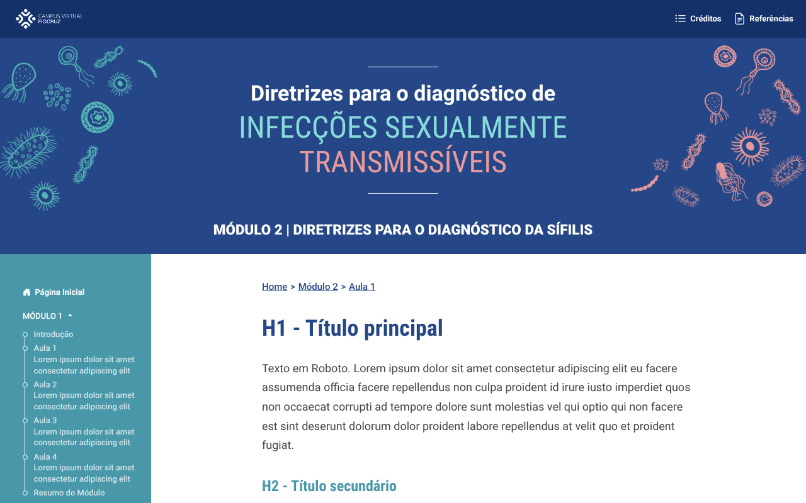
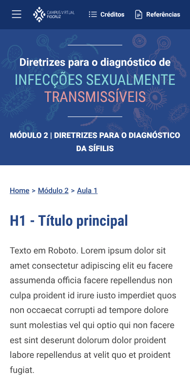

# Curso Base

**Base reutilizável para cursos online (EAD) feita só com HTML, CSS e JavaScript.**
Bootstrap 5.3 + Web Components nativos. Sem framework, sem build, sem jQuery.

> 🇬🇧 A reusable starter for e-learning courses built with plain HTML, CSS and JavaScript — Bootstrap 5.3 plus native Web Components, no framework and no build step.

[**Ver demonstração**](https://SEU-USUARIO.github.io/curso-base/) · [Como usar](#como-usar) · [Componentes](#componentes) · [Decisões técnicas](#decisões-técnicas)


## O problema

Cursos em HTML estático costumam repetir cabeçalho, menu lateral e rodapé em todas as páginas. Em um projeto anterior com 22 páginas, só o menu somava **139 KB de HTML duplicado**: incluir uma aula significava editar 21 arquivos à mão.

## A solução

Uma página de aula inteira é isto:

```html
<body>
  <curso-pagina>
    <h1>Título da aula</h1>
    <p>Texto da aula…</p>

    <curso-figura titulo="Gráfico 1" src="img/grafico.png" alt="…" fonte="MS, 2026"></curso-figura>
  </curso-pagina>

  <script src="../assets/js/curso.js"></script>
</body>
```

Topo, banner, menu lateral, trilha de navegação, botões Voltar/Avançar e rodapé são montados pelo componente, a partir de **um único arquivo de configuração**.

| Introdução de módulo | Aula | Celular |
|---|---|---|
|  |  |  |

## Destaques

- **Um arquivo descreve o curso.** Módulos, aulas e links ficam em `curso.config.js`; menu, breadcrumb, navegação e cards da home são gerados dele.
- **Uma tag de CSS e uma de JS por página.** `curso.css` e `curso.js` carregam todo o resto.
- **Tema por tokens.** Cores, fontes e medidas em `tokens.css`; adaptar a base a outro curso é trocar variáveis.
- **Dois temas de página** (`capa` e `aula`) com os mesmos componentes.
- **Funciona offline e dentro do AVA.** Bootstrap, ícones e fontes são locais; abre direto pelo `index.html`, sem servidor.
- **Responsivo.** O menu lateral vira painel deslizante em telas pequenas.
- **Acessibilidade.** HTML semântico, `aria-current` na página atual, link "pular para o conteúdo" e foco visível.

## Como usar

Baixe o repositório e abra o `index.html` no navegador. Não há instalação.

### Criar uma página

1. Copie `modulo2/aula1.html` e troque o conteúdo dentro de `<curso-pagina>`.
2. Informe o caminho do arquivo em `curso.config.js`:

```js
aulas: [
  { titulo: 'Introdução à sífilis', arquivo: 'modulo2/aula1.html' },
  { titulo: 'Diagnóstico laboratorial', arquivo: 'modulo2/aula2.html' }, // nova
],
```

Menu, trilha, título da aba e botões de navegação se atualizam em todas as páginas. Páginas ainda sem `arquivo` aparecem no menu como texto, sem link.

### Adaptar a outro curso

1. Edite `curso.config.js` (título, módulos e aulas).
2. Ajuste as cores em `assets/css/tokens.css`.
3. Troque as imagens em `assets/img/`.

## Componentes

| Componente | Função |
|---|---|
| `<curso-pagina tema="aula\|capa">` | Layout completo das páginas internas. Identifica a página pelo endereço. |
| `<curso-figura titulo src alt fonte legenda larga>` | Imagem com título acima e/ou legenda abaixo; `larga` ocupa a largura toda e amplia ao clicar. |
| `<curso-destaque titulo icone>` | Caixa tracejada (Leitura Complementar). |
| `<curso-caixa tipo="refletir\|sabia">` | Caixas "Para refletir" e "Você sabia?". |
| `<curso-nota titulo>` | Faixa azul de alerta. |
| `<curso-acordeao>` | Painéis que abrem e fecham. |
| `<curso-abas>` | Conteúdo em abas. |
| `<curso-carrossel>` | Slides com setas laterais. |
| `<curso-cartoes>` | Cartões que viram ao clicar. |
| `<curso-colunas>` | Comparação lado a lado. |
| `<curso-saiba-mais titulo>` | Botão que abre um conteúdo complementar. |
| `<curso-tabela titulo fonte>` | Envolve uma `<table>` com o estilo do curso e rolagem no celular. |
| `<curso-termo definicao>` | Termo com definição ao clicar. |
| `<curso-etapas>` | Passo a passo ligado por setas. |
| `<curso-video src titulo>` | Vídeo 16:9: link de incorporação ou arquivo `.mp4`. |
| `<curso-modulos>` | Cards dos módulos na home. |
| `<curso-navegacao>` | Voltar/Avançar; na home vira "Começar". |
| `<ul class="lista-setas">` | Lista com setas. |
| `<curso-topo>` `<curso-banner>` `<curso-menu>` `<curso-trilha>` `<curso-rodape>` | Peças de estrutura, já incluídas por `<curso-pagina>`. |

Abas, acordeão, carrossel, cartões e colunas recebem os itens como `<curso-item titulo="…">`. Quando o título precisa de formatação, use `<curso-titulo>` dentro do item:

```html
<curso-acordeao>
  <curso-item titulo="Transmissão sexual"><p>…</p></curso-item>
  <curso-item>
    <curso-titulo>VDRL (<i>Venereal Disease Research Laboratory</i>)</curso-titulo>
    <p>…</p>
  </curso-item>
</curso-acordeao>
```

**Convenção de texto:** `<i>` marca termos científicos e estrangeiros (*T. pallidum*, *in vitro*) e aparece em vermelho; `<em>` é ênfase comum. Links ainda sem endereço podem ficar como `<a>texto</a>`.

Os ícones usam os nomes do [Bootstrap Icons](https://icons.getbootstrap.com), por exemplo `icone="book"`.

### Criar um componente

```js
// assets/js/componentes/aviso.js
(function () {
  const { Componente, definir, esc } = window.Curso;

  definir('curso-aviso', class extends Componente {
    montar() {
      this.innerHTML = `<p class="aviso">${esc(this.attr('texto'))}</p>`;
    }
  });
})();
```

Depois, acrescente o arquivo à lista em `assets/js/curso.js` e os estilos em `assets/css/componentes.css`.

## Estrutura

```
curso.config.js            estrutura do curso (módulos, aulas, links)
index.html                 home
modulo2/                   páginas de exemplo (introdução e aula)
assets/
├── css/
│   ├── curso.css          ponto de entrada (importa os demais)
│   ├── tokens.css         cores, fontes, medidas e temas
│   ├── base.css           tipografia
│   ├── layout.css         topo, banner, menu, rodapé
│   ├── componentes.css    figura, destaque, vídeo, botões
│   └── home.css
├── js/
│   ├── curso.js           ponto de entrada (carrega os demais)
│   ├── nucleo.js          lê o config; página atual, anterior e próxima
│   └── componentes/       um arquivo por componente
├── img/
└── vendor/                Bootstrap, Bootstrap Icons e fontes Roboto
```

## Decisões técnicas

**Web Components sem Shadow DOM.** Custom Elements são nativos do navegador e dispensam framework. Sem Shadow DOM, as classes do Bootstrap e os tokens do tema valem dentro dos componentes, e o conteúdo continua sendo HTML comum.

**Sem etapa de build.** Quem mantém o conteúdo de um curso nem sempre é desenvolvedor. Editar um `.html` e recarregar a página é o fluxo inteiro.

**Scripts clássicos em vez de módulos ES.** `import` não funciona em páginas abertas por `file://`. Um carregador (`curso.js`) injeta os arquivos em ordem e descobre a raiz do curso pelo próprio endereço, então nenhuma página precisa informar caminhos relativos aos componentes.

**Configuração como fonte única.** A ordem das páginas no `curso.config.js` define menu, breadcrumb e navegação. Não há link de "próxima aula" escrito à mão em lugar nenhum.

**Dependências locais.** Cursos rodam em ambientes virtuais de aprendizagem e em redes restritas; depender de CDN é um ponto de falha.

**CSS por variáveis.** Os componentes consomem variáveis de tema (`--pagina-texto`, `--menu-fundo`…), o que permite os temas `capa` e `aula` sem duplicar regras.

## Tecnologias

HTML5 · CSS3 (custom properties, grid, `clamp()`) · JavaScript (ES2020, Custom Elements) · Bootstrap 5.3 · Bootstrap Icons · Roboto e Roboto Condensed

## Próximos passos

- [x] Accordion, abas, carrossel e flip card
- [ ] `<curso-quiz>` com feedback por alternativa
- [ ] Tabela responsiva
- [ ] Página de catálogo com todos os componentes

## Autor

**Eberthyn Marques** — desenvolvedor full stack em Brasília, DF.
[GitHub](https://github.com/SEU-USUARIO) · [LinkedIn](https://www.linkedin.com/in/SEU-USUARIO)
